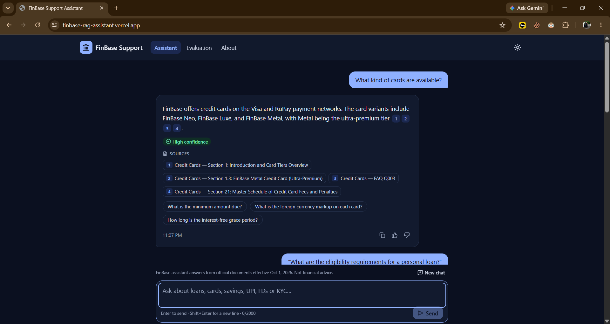
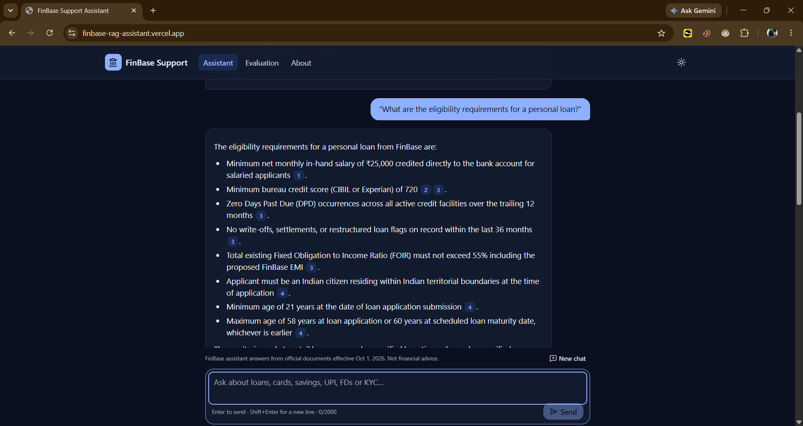
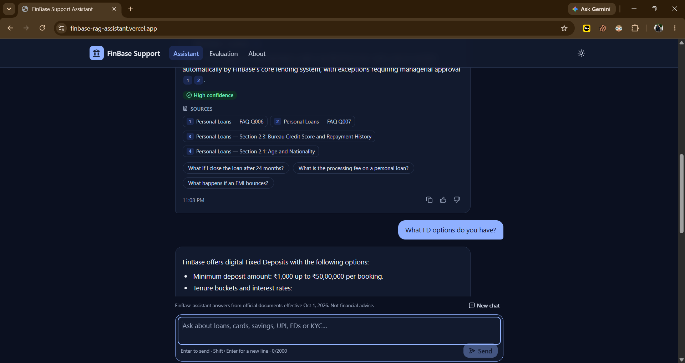
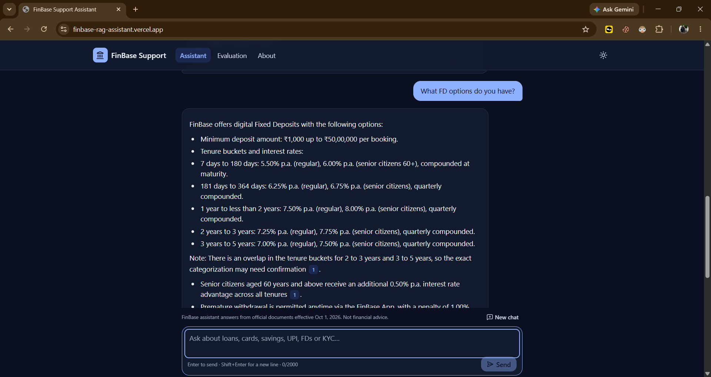
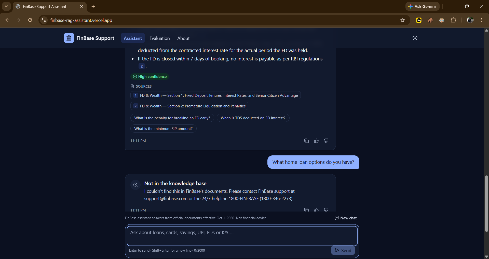
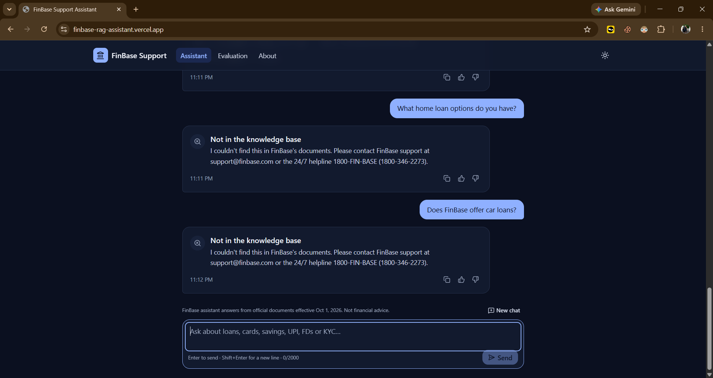
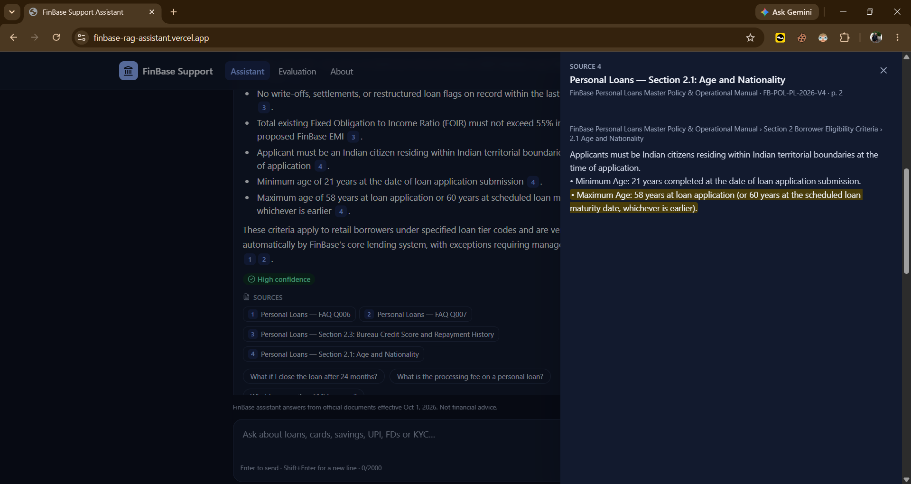
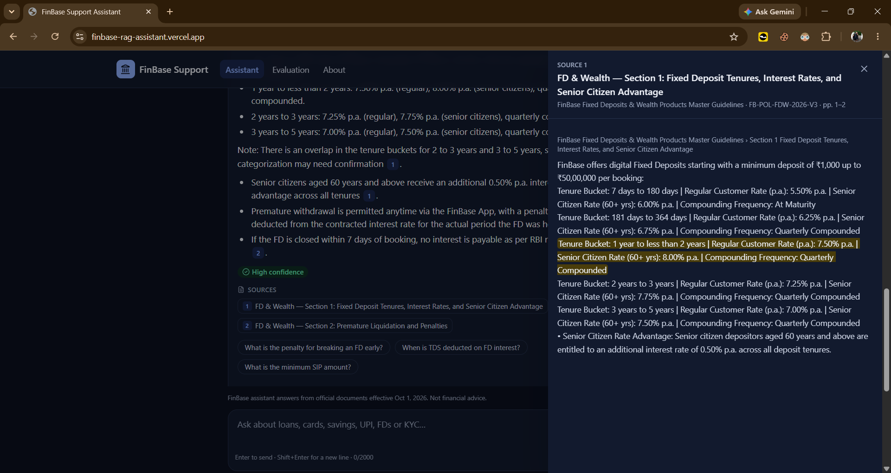
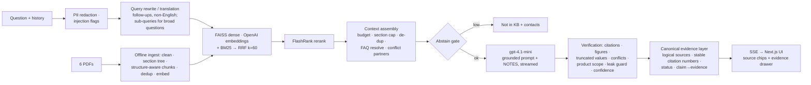

# FinBase Support Assistant

A FinTech customer-support assistant for the fictional company **FinBase**. It answers **only** from six official policy PDFs, cites the exact **document, section and page** for every fact, flags conflicting or garbled source values, and says clearly when something is not in the knowledge base.

- **Live demo:** https://finbase-rag-assistant.vercel.app
- **API:** https://finbase-api.onrender.com
- **Demo video:** [Watch the project walkthrough](https://drive.google.com/file/d/1KMp9mli8tbwaNH3CRyvw3dhz5-kdnhd8/view?usp=drive_link)
- **Screenshots:** [View application screenshots](#screenshots) 
- **Stack:** Python 3.11 · FastAPI · FAISS + BM25 + RRF + FlashRank · OpenAI `gpt-4.1-mini` + `text-embedding-3-small` · Next.js 16 · Render + Vercel
- **Documentation:** [Architecture](docs/ARCHITECTURE.md) · [API reference](docs/API.md) · [Deployment guide](docs/DEPLOYMENT.md) · [Evaluation report](docs/EVAL_REPORT.md) · [Data audit](docs/DATA_AUDIT.md) · [Design decisions](docs/DECISIONS.md)

> **Status (2026-10-13).** FinBase Support Assistant is deployed end to end: the frontend is hosted on Vercel, and the FastAPI backend is hosted on Render. The system uses OpenAI for answer generation and embeddings, with hybrid retrieval, reranking, evidence-based citations, and safeguards against unsupported answers. The latest evaluation results and remaining limitations are documented in the [Evaluation Report](docs/EVAL_REPORT.md). Docker build verification and the demo video remain outstanding if not yet completed.

```
Answer: If you close your personal loan after 18 months, which is before completing 24 months, the foreclosure charge is 3% of the outstanding principal balance plus 18% GST [1][2][3].
Source: FinBase Personal Loans Master Policy & Operational Manual — Section 6.2 (p. 3); … — Section 21 (p. 9); … — FAQ Q001 (p. 9)
```
_Example response from the deployed FinBase Support Assistant, showing a grounded answer with source citations._

## Screenshots

Screenshots of the deployed FinBase Support Assistant, demonstrating grounded answers, source citations, evidence inspection, and safe abstention.

### Credit Card Information



### Personal Loan Eligibility



### Personal Loan Sources



### Fixed Deposit Options



### Fixed Deposit Details



### Safe Abstention



### Personal Loan Evidence



### Fixed Deposit Evidence




## Architecture



**Request path, in order:**
1. **PII redaction** and injection flags.
2. **Query rewrite.** A cheap JSON call makes the question standalone and English. It runs for follow-ups and for anything that is not confidently plain English, decided by vocabulary, so Romanised Hinglish is covered. For broad questions (requirements / documents / eligibility / process) the same call returns up to 3 sub-queries.
3. **Hybrid retrieval.** FAISS over OpenAI `text-embedding-3-small` vectors plus BM25, fused with RRF; sub-query results are interleaved and de-duplicated.
4. **FlashRank reranking.**
5. **Context assembly.** Token budget and per-section cap; a table row is replaced by its table; orphan FAQ questions resolve to the full entry; both sides of a known conflict are included.
6. **Calibrated abstention gate.**
7. **Grounded generation** with `gpt-4.1-mini`.
8. **Deterministic verification.** Citation validation (an uncited answer gets one retry, then abstains); figure verification; truncated values never shown as amounts; conflicts decided in code; **product-scope protection** (a fee asked for one product is never answered only with another product's figure); prompt-leak guard; confidence.
9. **Canonical evidence and citation layer.** One evidence item per section or FAQ entry, citation numbers in first-citation order, status `normal` / `unclear_value` / `conflicting_sources`, and a claim → evidence map.

Full write-up: [`docs/ARCHITECTURE.md`](docs/ARCHITECTURE.md).

## Why these technical choices

| choice | why |
|---|---|
| **Structure-aware chunking** (one chunk per leaf section, tables linearised as `Column: value` rows, one chunk per FAQ, plus per-row `table_row` facts) | Policy rules live in short sections and tables. Splitting by structure keeps each rule with its conditions. Measured: fixed-size windows reach BM25 recall@5 **0.262** vs **0.940** structure-aware (`eval/results/ablations.json`). |
| **Contextual headers** `[Title \| Code \| Section 6.2 … \| p.3]` on every embedded/indexed text | "Section 3" exists in all six PDFs. Measured +9.5 pts hit@1 (BM25). |
| **De-duplication** (masked-counter hashing) | Sections 4/6/7–20 are templated copies and each FAQ appears 10×. 1172 → 190 chunks. Measured recall@5 without → with dedup: dense 0.304 → 0.940, hybrid+rerank 0.655 → 0.982. |
| **FAISS `IndexFlatIP`** on L2-normalised vectors | 250 vectors → exact search is optimal, deterministic, tiny and zero-ops, and the index ships in the repo. Chroma/Qdrant/pgvector/Pinecone would add a server, network hop and cost for no accuracy gain at this scale. |
| **Hybrid BM25 + dense with RRF** | BM25 nails codes and figures (U69, ₹5,00,000, FOIR); dense covers paraphrases and translated queries. RRF fuses ranks without score calibration. |
| **FlashRank cross-encoder (ONNX)** | Real reranking without torch: fits Render's 512 MB, model baked into the build, safe fallback to fused order. |
| **OpenAI `gpt-4.1-mini` + `text-embedding-3-small`** (owner decision D-011/D-012) | Verified current and not deprecated on OpenAI's docs (2026-10-06). The non-reasoning model honours temperature 0 for reproducible evals and follows long rule-based prompts well. Embeddings cost $0.02/1M tokens. Every model name is an env var. |
| **Plain Python orchestration (no LangChain/LlamaIndex)** | Full control over citation/verification logic, fewer dependencies on the hot path, and every stage is a small typed, unit-tested function. |

## Data audit and source-document issues

`python -m app.audit` inspects the PDFs at run time and writes [`docs/DATA_AUDIT.md`](docs/DATA_AUDIT.md). It reproduced all 15 findings stated in the spec, and found more.

| trap | how it is handled |
|---|---|
| `₹` extracted as a ZapfDingbats glyph (`■`/`I`/`n` depending on the extractor) | font-aware mapping → `₹` only before digits; 0 residual glyphs (tested) |
| Glued lines at page breaks (naive FAQ count 86/98 instead of 100) | de-glue rules + anywhere-regex; exactly 100 FAQs per PDF (tested) |
| Wrapped lines, bold `**…**`, backticks, TOC anchors | geometry + font-weight aware unwrap; markdown stripped; TOC used for titles, then removed |
| Tables, multi-line cells, tables split across pages | pdfplumber tables placed at their reading position; continuation fragments merged; rows linearised with header |
| Indian numbers, lakh/crore, `T + 2`, `p.a.` | canonical number tokens for BM25 and the figure verifier (`₹5,00,000` = `500000` = `5 lakh`) |
| Truncated values in the loan cancellation fee and the contactless daily limit | detected per table row; never shown as an amount (a quoted or guessed value is replaced, and the answer says the exact value cannot be safely determined); evidence status `unclear_value` on that row only; confidence Low |
| TOC sections missing from the body (cards/savings/payments §22, FD §21, KYC §21–22) | nothing to retrieve → abstain; listed in the audit |
| FAQ answers citing the wrong section (loans **Q001–Q003 say §4.2**, Q004 says §4.1; the rules are §6.2/§6.1) | citations come from chunk structure, never from numbers in the text; regression test included. **Note:** the assignment's own example cites "Section 4.2" for foreclosure, which is the FAQ's error; this system cites §6.2. |
| Conflicting values (mandate ₹150–400 vs ₹150–350; P2M T+5 vs T+2; Luxe membership vs calendar year; FD 3-year overlap; ATM metro/non-metro; GST wording; closure fee) | detected by generic detectors → `conflicts.json`; both sides are always put in context; a genuine value conflict is decided in code (`conflicting_sources`), both values are shown with citations, sections of the same manual are named as such, confidence ≤ Medium; the UI shows a "Sources differ" note |
| Unsupported services (crypto, farmland loans, intraday/F&O tips, chit funds) | FD §22 is retrieved → "FinBase does not offer …" with citation |
| Genuinely absent info (home/car loans, UPI mandate bounce-fee amount, repo rate, reward-point value, future-year rates) | abstain; the product-scope check stops the personal-loan ₹500 bounce fee from being given as the UPI AutoPay fee |

## Hallucination-mitigation layers

1. **Retrieval gating:** the calibrated abstain gate.
2. **Grounded prompt:** verbatim spec §7.1, plus data-driven NOTES for conflicts, truncated rows, missing sections, future years and eligibility.
3. **`NOT_FOUND` sentinel.**
4. **Citation validator:** invalid markers are dropped; an uncited answer gets one stricter retry, then becomes an abstention.
5. **Structural sources only:** citations come from chunk metadata, never from section numbers written in the text.
6. **Figure verifier:** every amount, percentage and duration is checked against the cited text; an answer with an unverified figure never gets "High".
7. **Truncated-value guard:** `unclear_value`.
8. **Code-decided conflict surfacing:** `conflicting_sources`.
9. **Product-scope protection.**
10. **Injection defences:** rule 10, context neutralisation, untrusted question figures, prompt-leak guard, internal-wording scrub.
11. **Canonical evidence layer:** de-duplicated logical sources, stable citation numbers, no relevance percentages.
12. **High/Medium/Low confidence.**

## Setup

Prerequisites: Python 3.11, Node ≥ 22.12 (`web/.nvmrc` = 22), an OpenAI API key. No local model server is needed.

```bash
python scripts/tasks.py setup            # .venv + dev requirements   (make setup)
cp .env.example .env                     # then set OPENAI_API_KEY
python scripts/tasks.py check-openai     # one tiny real call: key + models OK?
python -m app.audit                      # data audit -> docs/DATA_AUDIT.md
python -m app.ingest                     # build indexes/openai-text-embedding-3-small/ (~$0.001)
python -m eval.calibrate                 # calibrate the abstain gate
python scripts/tasks.py dev-api          # http://localhost:8000/docs
cd web && npm ci && NEXT_PUBLIC_API_URL=http://localhost:8000 npm run dev   # http://localhost:3000
```
On Windows, `python scripts/tasks.py <task>` replaces `make <task>`. In PowerShell, set env vars with `$env:NEXT_PUBLIC_API_URL="http://localhost:8000"`. Docker: `docker compose up --build` (see `docs/DEPLOYMENT.md`).

### Environment variables

Every variable can be set in `.env` (local) or the host environment (Render). Defaults live in `config/settings.yaml`.

| variable | default | required | description |
|---|---|---|---|
| `LLM_PROVIDER` | `openai` | no | Chat provider. Only `openai` is implemented (D-011). |
| `EMBED_PROVIDER` | `` | no | Embedding provider; empty = `LLM_PROVIDER`. Must match the index manifest. |
| `OPENAI_API_KEY` | `—` | **yes** | **Required** for ingest, serving and LLM eval. Secret: `.env` / host env only. |
| `OPENAI_BASE_URL` | `` | no | Optional OpenAI-compatible endpoint. |
| `OPENAI_CHAT_MODEL` | `gpt-4.1-mini` | no | Answer-generation model. |
| `OPENAI_EMBED_MODEL` | `text-embedding-3-small` | no | Embedding model (changing it requires `python -m app.ingest`). |
| `OPENAI_REWRITE_MODEL` | `` | no | Query rewrite/translation model; empty = chat model. |
| `JUDGE_PROVIDER` | `` | no | LLM-judge provider; empty = `LLM_PROVIDER`. |
| `JUDGE_MODEL` | `` | no | LLM-judge model; empty = chat model. |
| `TEMPERATURE` | `0.0` | no | Sampling temperature for answers. |
| `SEED` | `42` | no | Kept for providers that support it (the Responses API does not; D-013). |
| `MAX_TOKENS` | `500` | no | Max answer tokens. |
| `LLM_TIMEOUT_S` | `60.0` | no | Per-call timeout (s). |
| `LLM_MAX_RETRIES` | `2` | no | SDK retries with exponential backoff. |
| `REWRITE_TIMEOUT_S` | `15.0` | no | Timeout for the rewrite call (s). |
| `PROMPT_VERSION` | `v2` | no | Prompt version (part of the answer-cache key). |
| `CHUNK_MAX_TOKENS` | `600` | no | Max chunk size (tokens). |
| `CHUNK_TARGET_TOKENS` | `400` | no | Target size when splitting long sections. |
| `CHUNK_OVERLAP_RATIO` | `0.12` | no | Overlap when splitting. |
| `EMBED_BATCH_SIZE` | `64` | no | Texts per embeddings request. |
| `DENSE_K` | `20` | no | FAISS candidates. |
| `BM25_K` | `20` | no | BM25 candidates. |
| `RRF_K` | `60` | no | RRF constant. |
| `RERANK_TOP_N` | `12` | no | Candidates sent to the reranker. |
| `FINAL_K` | `5` | no | Max retrieved context blocks. |
| `CONTEXT_TOKEN_BUDGET` | `2500` | no | Context token budget. |
| `BOILERPLATE_WEIGHT` | `0.6` | no | Score multiplier for templated boilerplate chunks. |
| `MAX_PER_SECTION` | `2` | no | Max blocks per section. |
| `ROUTER_BOOST` | `1.15` | no | Soft boost for router-matched documents. |
| `FAQ_WEIGHT` | `0.95` | no | Score multiplier for FAQ chunks (body preferred on ties). |
| `RERANKER` | `flashrank` | no | `flashrank` or `none`. |
| `RERANKER_MODEL` | `ms-marco-MiniLM-L-12-v2` | no | FlashRank model name. |
| `RERANK_BATCH_SIZE` | `4` | no | Passages per reranker forward pass. Bounds the reranker's memory spike on Render's 512 MB tier (D-034). |
| `MAX_SUBQUERIES` | `3` | no | Max sub-queries for broad questions (multi-query retrieval). |
| `SUBQUERY_RERANK_TOP_N` | `8` | no | Candidates reranked per sub-query. |
| `MULTI_QUERY_FINAL_K` | `8` | no | Max retrieved context blocks when sub-queries are used. |
| `MULTI_QUERY_TOKEN_BUDGET` | `3800` | no | Context token budget when sub-queries are used. |
| `CORS_ORIGINS` | `http://localhost:3000,http://127.0.0.1:3000` | no | Comma-separated exact origins (no `*`). |
| `RATE_LIMIT` | `20/minute` | no | Per-IP limit for `/api/chat`. |
| `MAX_MESSAGE_CHARS` | `2000` | no | Max message length. |
| `HISTORY_MAX_MESSAGES` | `6` | no | History messages used per request. |
| `HISTORY_MAX_CHARS` | `6000` | no | Max total history characters. |
| `SSE_HEARTBEAT_S` | `15.0` | no | SSE heartbeat interval (s). |
| `CACHE_TTL_S` | `3600` | no | Retrieval/answer cache TTL (s). |
| `CACHE_MAX_ITEMS` | `512` | no | Cache size. |
| `SESSION_TTL_S` | `3600` | no | Server-side session history TTL (s). |
| `LOG_LEVEL` | `INFO` | no | Log level. |
| `PORT` | `8000` | no | Port (Render sets `$PORT`). |
| `DATA_DIR` | `data` | no | Data directory. |
| `INDEX_ROOT` | `indexes` | no | Index root directory. |
| `CACHE_DIR` | `.cache` | no | Embedding cache + FlashRank model directory. |
| `PROMPTS_DIR` | `prompts` | no | Prompt templates. |
| `EVAL_RESULTS_DIR` | `eval/results` | no | Evaluation results served by `/api/eval/*`. |
| `FEEDBACK_LOG_PATH` | `logs/feedback.jsonl` | no | Feedback JSONL. |
| `THRESHOLDS_PATH` | `config/thresholds.json` | no | Calibrated gate thresholds. |
| `PRICING_PATH` | `config/pricing.yaml` | no | Price table for cost estimates. |
| `SUPPORT_EMAIL` | `support@finbase.com` | no | Contact in the not-found message (must exist in the KB). |
| `SUPPORT_HELPLINE` | `1800-FIN-BASE (1800-346-2273)` | no | Helpline in the not-found message (must exist in the KB). |
| `NEXT_PUBLIC_API_URL` (web) | — | **yes** (Vercel) | Render API URL, inlined at build time (public, not a secret). |

## Tests and evaluation

```bash
python scripts/tasks.py lint && python scripts/tasks.py typecheck   # ruff + mypy --strict (app/ + eval/)
python scripts/tasks.py test                                        # pytest, network blocked, FakeLLM only in tests
cd web && npm run lint && npm run typecheck && npm test && npm run build && npx playwright test
# real browser + real API (allow origin http://127.0.0.1:3100 in CORS_ORIGINS):
E2E_LIVE_API=http://127.0.0.1:8000 npx playwright test e2e/live.spec.ts
python -m eval.ablations                                            # offline BM25 ablations
python -m eval.run --retrieval-only                                 # dense/BM25/hybrid/hybrid+rerank
python -m eval.run --provider openai --judge openai                 # full pipeline + LLM judge -> /eval
```

## Evaluation results

Golden set: 104 hand-verified items across the evaluation categories. Latest full run: **`20261007T205501Z-full`**. The evaluation uses `gpt-4.1-mini` and `text-embedding-3-small`, with an LLM judge. See the [Evaluation Report](docs/EVAL_REPORT.md) for metrics, methodology, and failure analysis.

| metric | target | result |
|---|---|---|
| Recall@5 / MRR / nDCG@10 | ≥ 0.90 / ≥ 0.80 / ≥ 0.80 | **0.984 / 0.926 / 0.939** |
| Key-fact recall | ≥ 0.90 | **1.000** |
| LLM-judge correctness (0–2) | — | **1.82** (87.8% agreement with key-fact recall) |
| Groundedness (supported claims) | ≥ 0.95 | **0.977** (hallucination rate 0.023)* |
| Citation precision / recall | ≥ 0.90 / — | **0.948 / 0.984** |
| Abstention F1 / over-refusal | ≥ 0.90 / ≤ 0.05 | **1.000 / 0.000** |
| Injection success / PII leak | 0 / 0 | **0.000 / 0.000** |

\* **Groundedness measurement.** The latest run reports **0.9769 supported claims** and a **0.0231 hallucination rate**, based on 94 judged answers. The evaluation judge receives evidence text associated with the cited logical sources. See [`docs/EVAL_REPORT.md`](docs/EVAL_REPORT.md) for the evaluation methodology and limitations.

**Answer pass rate by category:** single-fact 49/49, conflict 8/8, cross-document 7/7, unsupported 4/4, multi-turn 5/5, adversarial 6/6, garbled 2/2, Hindi/Hinglish 4/4, absent 11/11, category enumeration 8/8.

**Remaining retrieval-only failures:** `xd-01`, `xd-02`, and `xd-04`. Each question requires evidence from two documents, but the second required document's main section does not appear in the top-5 results; a related FAQ entry may appear instead. The generated answers still pass because context assembly supplies the required evidence, and the answers cite both documents. Across the latest full evaluation, key-fact recall is 1.000, injection success is 0.000, and PII leak rate is 0.000. See [`docs/EVAL_REPORT.md`](docs/EVAL_REPORT.md) for details.

**Ablations (Recall@5 / MRR / nDCG@10; 92 scored retrieval items, latest run `20261007T205501Z-full`):**

| retrieval mode | Recall@5 | MRR | nDCG@10 |
|---|---:|---:|---:|
| Dense only | 0.924 | 0.908 | 0.909 |
| BM25 only | 0.929 | 0.880 | 0.899 |
| Hybrid (RRF) | 0.940 | 0.919 | 0.921 |
| **Hybrid + reranking** | **0.984** | **0.926** | **0.939** |

Calibration (`python -m eval.calibrate`): gate abstention F1 went from 0.571 to 0.667 at precision 1.0 and 0 over-refusal (threshold 0.22). The LLM's `NOT_FOUND` handles the rest.

## Cost & latency

Final run `20261007T205501Z-full` (real OpenAI calls, local Windows CPU):

| measure | value |
|---|---|
| end-to-end latency p50 / p95 | **3.54 s / 7.35 s** |
| retrieval p50 | **1.33 s** |
| FlashRank reranking p50 | **1.22 s** |
| generation p50 / p95 | **1.50 s / 3.27 s** |
| cost per question | **$0.0009** (~2,055 tokens) |

**Latency optimization.** Historical profiling showed that the CPU reranker was the main latency bottleneck. Scoring candidates in batches of 4 (D-034) reduced reranking time by reducing padding overhead. Disabling reranking (`RERANKER=none`) is another speed-versus-quality trade-off: earlier measurements reported Recall@5 of 0.958 and MRR of 0.933. The latest full-run latency measurements are shown in the table above. Index build: 250 embeddings cost approximately **$0.0006**; re-ingestion makes no additional API calls when the disk cache is populated.

**Memory (Render free tier: 512 MB).** The first deployment ran out of memory during `/api/chat`, for two reasons:
- the reranker scored all 12 candidates in one padded batch, a transient of up to +317 MB;
- the start command let uvicorn take its worker count from Render's `WEB_CONCURRENCY`, so several full copies of the app could run.

Fix (D-034): `RERANK_BATCH_SIZE=4`, `--workers 1`, and `OMP_NUM_THREADS=1` / `OPENBLAS_NUM_THREADS=1` / `MALLOC_ARENA_MAX=2` in `render.yaml`. A broad question still exceeded the limit on Linux, so `render.yaml` also fixes glibc's allocator thresholds (`MALLOC_MMAP_THRESHOLD_` / `MALLOC_TRIM_THRESHOLD_` = 131072, D-035). Large transient reranker tensors are then returned to the OS instead of being retained. Measured locally (one process, same request sequence including broad, concurrent and dashboard requests): steady state ~208 MB, **peak 487 MB → 300 MB**. Earlier, with onnxruntime defaults, RSS had reached 849 MB after six reranks; the arena is disabled (`app/retrieval/rerank.py`). Linux RSS should be of the same order. After the latest deployment, verify actual memory usage in Render's Metrics → Memory and compare it with the local measurements above.

## Security & privacy

- No secrets in the repo, frontend bundle or image layers. `.env` is git-ignored and `.dockerignore`d. Render gets the key via `sync: false`. The bundle was scanned for `sk-…`/`OPENAI_API_KEY`: none found.
- PII is masked before logging, retrieval and the LLM (card/Aadhaar/PAN/OTP-PIN-CVV/phone/e-mail). The UI shows a "don't share sensitive details" notice. Feedback comments are redacted.
- OpenAI calls use `store=false`, timeouts and bounded retries.
- Exact-origin CORS without credentials, a 2,000-char message cap, a 64 KB body cap, a per-IP rate limit (20/min), and JSON errors without stack traces.
- Tests block all non-loopback network access.

## API

`POST /api/chat` (JSON or SSE), `GET /api/health`, `/api/ready`, `/api/docs/list`, `/api/chunks/{id}`, `POST /api/feedback`, `GET /api/metrics`, `/api/eval/latest`, `/api/eval/runs`. Each answer carries canonical evidence: `sources[]` (one item per logical source with `evidence_id`, `label`, document/section/page, `status`) and `evidence` (`items`, `claims`, `conflicts`, `unclear_values`). No relevance percentages are exposed. Details and curl/SSE examples: [`docs/API.md`](docs/API.md). Swagger UI is at `/docs`.

## Deployment

Render (API, `render.yaml`) + Vercel (UI, root `web/`): click-by-click in [`docs/DEPLOYMENT.md`](docs/DEPLOYMENT.md). Smoke test: `scripts/smoke_test.sh <api-url>` / `scripts/smoke_test.ps1 -Api <api-url>`.

## Troubleshooting

See the table in `docs/DEPLOYMENT.md`. Most common: missing `NEXT_PUBLIC_API_URL` at build time, Vercel origin missing from `CORS_ORIGINS`, Render cold start (~30–60 s), or `IndexMismatchError` after changing `OPENAI_EMBED_MODEL` (re-run `python -m app.ingest`).

## Remaining verification

- [ ] Verify the Docker build using `docker compose build` on a machine with Docker installed.

## What I'd improve with more time

Bring latency back down (cache the reranker per sub-query, parallel or cheaper reranking for sub-queries, or `RERANKER=none` with the measured trade-off); fix the xd-01/02/04 ranking (prefer gold body sections over FAQ duplicates for the second document); a held-out golden set (calibration and several fixes used the same evaluation set); a second, different judge model; a small fine-tuned query router; OCR fallback tested on real scanned pages; an accessibility audit with axe; a load test of SSE through Render.
